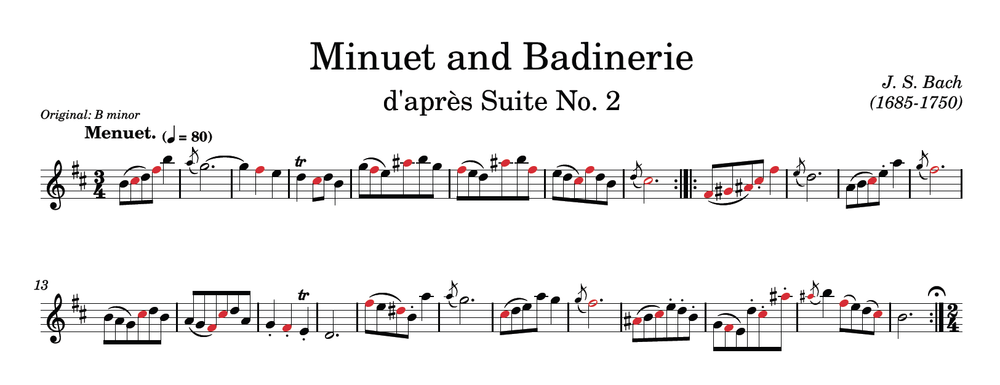

# Accidental Color

[日本語](#日本語) · [English](#english) · [Download ZIP](https://github.com/shingoaoki1985/musescore-accidental-color/archive/refs/heads/main.zip)

*J. S. Bach, Minuet and Badinerie — 色分け後の譜例 / excerpt after applying colors.*

## 日本語

Accidental Colorは、五線譜の♯や♭を見分けやすくするMuseScore Studio 4用の読譜支援プラグインです。調号で変化する音も、臨時記号で変化する音も、音符の横に記号が表示されるかどうかにかかわらず色分けします。音名の表記を基準にするため、同じ高さのC♯とD♭も別の色になります。

| 記譜音 | 初期配色 |
| --- | --- |
| ♯・𝄪 | 赤 `#D52E35` |
| ♭・𝄫 | 青 `#3478C6` |
| ナチュラル | 黒 `#000000` |

### インストール

1. **Code → Download ZIP** からダウンロードして解凍します。
2. 解凍した中の `AccidentalColor` フォルダーを、MuseScore Studioの **環境設定 → フォルダー** に表示されるプラグインフォルダーへコピーします。`AccidentalColor.qml` と `AccidentalColor.png` は同じフォルダーに入れてください。
3. MuseScore Studioの **プラグイン → プラグインを管理** で **Accidental Color – Sight-Reading Assistant** を有効にします。一覧に出ない場合はMuseScore Studioを再起動してください。

### 使い方

1. 楽譜を開き、プラグインメニューから **Accidental Color – Sight-Reading Assistant** を起動します。
2. 処理対象と配色を指定して **色分けを適用** を押します。自動モードでは選択範囲が優先され、選択がなければ楽譜全体に適用されます。特定の音符・五線・パートも処理対象にできます。
3. 実音表示と移調譜表示を切り替えた場合は、表示中の記譜音に合わせて再適用します。

適用直後はUndoで以前の配色に戻せます。**色分けを解除** は既存の独自色を含め、楽譜全体の音符を黒にします。色分け後の譜面はMSCZに保存し、カラーPDFに出力できます。

**検証環境**　MuseScore Studio 4.7.7 / Windows 11。検証済みの範囲は色分け処理、Undo、MSCZ再読み込み、カラーPDF出力です。

## English

Accidental Color is a sight-reading aid for MuseScore Studio 4. It colors notes affected by key signatures or accidentals, even when no accidental sign appears beside the note. Colors follow the displayed spelling, so C♯ and D♭ receive different colors even when they sound at the same pitch.

| Written note | Default color |
| --- | --- |
| ♯ or 𝄪 | Red `#D52E35` |
| ♭ or 𝄫 | Blue `#3478C6` |
| Natural | Black `#000000` |

### Installation

1. Select **Code → Download ZIP**, then extract the archive.
2. Copy the `AccidentalColor` folder into the plugins folder shown under **Preferences → Folders** in MuseScore Studio. Keep `AccidentalColor.qml` and `AccidentalColor.png` together.
3. Enable **Accidental Color – Sight-Reading Assistant** under **Plugins → Manage plugins**. Restart MuseScore Studio if it does not appear in the list.

### Usage

1. Open a score and launch **Accidental Color – Sight-Reading Assistant** from the Plugins menu.
2. Choose the scope and colors, then select **Apply colors**. Automatic mode uses the current selection when present and the whole score otherwise. You can also target individual notes, staves, or parts.
3. Reapply after switching between concert pitch and transposed display to match the spelling currently shown.

Use Undo immediately after applying colors to restore the previous colors. **Reset colors** sets every note in the score to black, including previously customized notes. You can save the colored score as MSCZ or export it as a color PDF.

**Tested with** MuseScore Studio 4.7.7 on Windows 11. Testing covered color application, Undo, reopening MSCZ files, and color PDF export.
